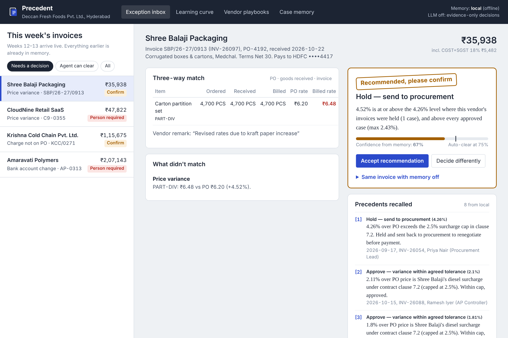
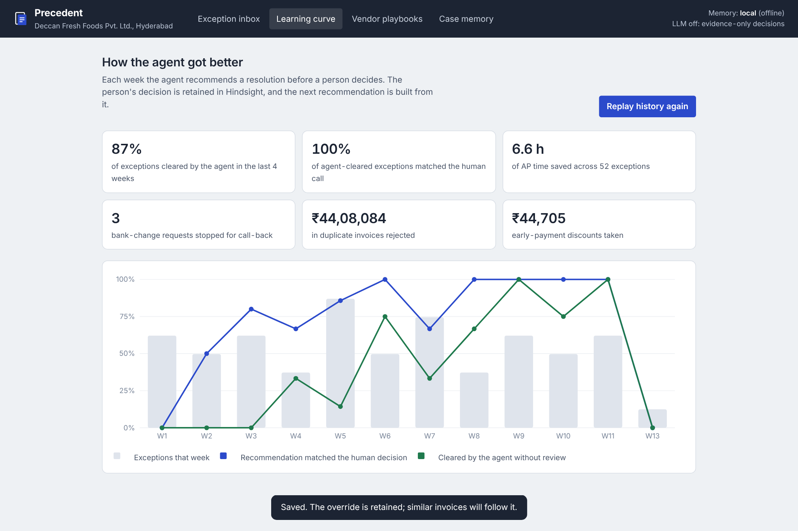
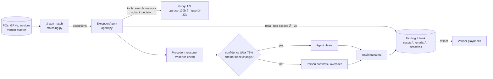

# Precedent — the AP exception desk that remembers how you decided last time

> An Accounts Payable agent built on **Hindsight** memory. It reads invoices that fail 3-way match,
> recalls how *your* team resolved the same vendor's same problem before, and recommends the
> resolution with the past decisions cited as precedent. Every human decision is retained, so the
> agent earns the right to clear exceptions on its own, one case at a time.



---

## The problem

Every mid-size company runs a 3-way match: purchase order ↔ goods receipt (GRN) ↔ vendor invoice.
The 20–40% of invoices that don't match land on an AP executive's desk. The painful part is that
**the same exceptions recur, and the knowledge of how to handle them lives in one senior person's head**:

| What the invoice shows | What the senior controller knows |
|---|---|
| Shree Balaji Packaging billed 2.1% above PO | Clause 7.2 lets them add a diesel surcharge up to 2.5%. Approve. Above 2.5%, send to procurement. |
| Nizam Agro billed 45 QTL against a PO for 4,500 KG | Their ERP bills in quintals. Convert and approve. |
| Godavari Logistics billed 100 pallets, GRN shows 55 | They always invoice the full PO on the first dispatch. Hold until the balance arrives. |
| Guntur Spice Traders charged CGST+SGST | They're in Andhra Pradesh, we're in Telangana: must be IGST. Send it back or we lose ITC. |
| Deccan Print sent `DPL/0412/R` | That's a re-send of `DPL/0412` they do when payment is near due. Reject. |
| "Our bank account has changed, remit to the new one" | Never. Call back on the number in the vendor master. Two of the last three were fraud. |

When that controller is on leave, invoices pile up, duplicates get paid, discounts expire, and fake
bank-change letters get through. A stateless LLM can't help: it doesn't know clause 7.2 exists or
that this vendor bills in quintals. **The value is entirely in the memory.**

## What Precedent does

1. **Detect.** A deterministic 3-way match flags price variance, quantity, unit-of-measure, GST type,
   unplanned charges, duplicates, bank-detail changes and early-payment discounts.
2. **Recall.** For each exception it asks Hindsight for precedents: same vendor + same exception type,
   then the same exception type across vendors (for company-policy issues), then vendor correspondence.
3. **Decide.** An LLM (Groq `gpt-oss-120b`, fallback `qwen3-32b`) weighs the precedents, vendor emails
   and policy, and calls `submit_decision`. An auditable precedent reasoner checks that decision against
   the evidence: **the LLM can never claim more confidence than memory supports.**
4. **Clear or route.** ≥75% confidence → the agent clears it. Below that → a person confirms with one
   click. Bank-account changes always go to treasury, whatever the confidence.
5. **Learn.** The person's decision, reason, and whether they agreed with or overrode the agent is
   retained in Hindsight. The next invoice is decided with that knowledge.

## The learning curve (from the included 13-week dataset)



| | Week 1 | Last 4 weeks |
|---|---|---|
| Recommendation matched the human decision | 0% | **100%** |
| Exceptions cleared without review | 0% | **88%** |
| Wrong auto-clears | — | **0** (100% precision) |

Memory OFF on the same data: 0% auto-cleared, every exception escalated. Run
`python scripts/before_after.py` to see each live invoice decided both ways.

## How Hindsight memory is used

Memory is not a feature bolted on to a chatbot here; the agent's confidence is *derived from* what it
recalls. Full detail in **[docs/HINDSIGHT_MEMORY.md](docs/HINDSIGHT_MEMORY.md)**.

| Hindsight capability | Where Precedent uses it |
|---|---|
| `create_bank` with `retain_mission`, `reflect_mission`, observations | One bank per AP desk, tuned to extract vendor, discrepancy size, resolution, approver and reason ([hindsight_backend.py](app/memory/hindsight_backend.py)) |
| **Directives** | Hard rules Hindsight applies during reflect: bank changes need a call-back, never pay twice, pay only what was received |
| `retain` with `tags`, `metadata`, `document_id`, `timestamp` | Every resolved exception (and every override, with the lesson) becomes a case document tagged `vendor:`, `exception:`, `action:`, `mag:` ([narratives.py](app/narratives.py)) |
| `recall` with `tags_match="all_strict"` / `"any_strict"` | Three scoped recalls per exception: this vendor + this exception, this exception across vendors, this vendor's correspondence ([agent.py](app/agent.py)) |
| `reflect` with `response_schema` | Vendor playbooks: a structured briefing a new AP executive can read ([agent.py](app/agent.py) `vendor_playbook`) |
| Temporal memory | Cases are timestamped with the invoice date, so "what did we do last month" works and newer decisions outweigh older ones |
| LLM tool `search_memory` | The LLM can query Hindsight mid-decision when the pre-loaded precedents aren't enough |

## Architecture



```
app/
  matching.py           3-way match → typed exceptions with magnitudes
  agent.py              recall → LLM tool loop → evidence check → decision; learn(); vendor_playbook()
  reasoner.py           precedent voting + learned tolerance thresholds (approve ceiling / hold floor)
  llm.py                OpenAI-compatible client: retries, Groq tool_use_failed handling, JSON repair
  memory/
    hindsight_backend.py  production memory: hindsight-client SDK on one dedicated event loop
    local_backend.py      offline stand-in for tests (same interface) + NullMemory (memory OFF)
  narratives.py         turns AP events into Hindsight documents (content + tags + metadata)
  service.py            AP workflow, case ledger, replay, metrics
  server.py             Flask API (app factory);  static/  the web UI
  doctor.py             python -m app.doctor: setup checker
data/                   generate_data.py + the generated dataset (114 invoices, 12 vendors)
scripts/replay.py       seed the bank with 11 weeks of history and print the learning curve
scripts/before_after.py same invoices, memory OFF vs ON
tests/                  30 tests: matching, learning, LLM failure modes, real-SDK integration, HTTP API
setup.bat / setup.sh    one-command setup;  SETUP.md  step-by-step guide
```

## Run it

**Windows:** double-click `setup.bat`, paste your keys when Notepad opens, then:

```powershell
.venv\Scripts\activate
python scripts\replay.py      # first time only: loads 11 weeks of history into Hindsight (~4 min)
python -m app.server          # http://localhost:8000
```

**macOS / Linux:** `bash setup.sh`, then the same two commands with `source .venv/bin/activate`.

Full walkthrough and troubleshooting: **[SETUP.md](SETUP.md)**. If anything looks off, run
`python -m app.doctor`; it checks Python, packages, `.env`, Hindsight (including from several threads
at once, as the web server uses it), Groq and the loaded history, and names the fix.

The last two weeks of invoices are left unprocessed so you can work the live inbox: accept a
recommendation, or override one and watch the next similar invoice change.

**Offline:** set `MEMORY_BACKEND=local` in `.env` for an in-process stand-in with no fact extraction.
It's for tests and laptops without network; the submission demo uses Hindsight.

**Tests:** `python -m pytest -q`. 30 tests, including the real `hindsight-client` SDK driven over HTTP
against a local Hindsight-compatible server (`tests/fake_hindsight_server.py`) from many threads at
once, plus a full 11-week replay through it.

## Edge cases handled

- **LLM function-calling failures** (the brief's warning): Groq `tool_use_failed` → re-prompt, then switch
  to the fallback model; malformed JSON arguments → repaired or returned to the model as a tool error;
  invalid action → re-prompt with the allowed list; prose instead of a tool call → nudged, then
  `tool_choice=required`; provider down → decision made from memory evidence alone, with a visible warning.
- **LLM vs memory disagreement**: confidence capped at 50%, flagged, sent to a person.
- **No precedent**: LLM may suggest, capped at 40%; a person decides and that becomes the first precedent.
- **Out-of-range magnitudes**: a 9% variance from a vendor whose approvals stop at 2.5% isn't approved
  because "they usually get approved". Tolerances are learned as thresholds, and the grey zone between the
  highest approval and the lowest hold always goes to a person.
- **Fact fan-out**: Hindsight extracts several facts per case; recall de-duplicates by `document_id`
  so one case is one vote. Consolidated observations inform the LLM but never vote.
- **Overrides**: retained with the reviewer's lesson and tagged `outcome:overridden`; newer decisions
  outweigh older ones.

## Business case

A 6-person AP team at a ₹500 Cr FMCG processes ~3,000 invoices a month; at a 30% exception rate and
~14 minutes each that's ~210 hours a month. On the sample data Precedent clears 88% of exceptions by
week 10 with zero wrong auto-clears. Beyond time: duplicates blocked (₹44 lakh in the sample), early-pay
discounts captured, and bank-change fraud stopped at the call-back step. Pricing that works for buyers:
₹15k–₹40k/month per AP desk, cheaper than one AP executive's salary.

## Hackathon deliverables

- [x] Built on Hindsight (retain, recall, reflect, directives, tags, observations)
- [x] Clean, documented code with tests
- [x] Demo video script: [docs/DEMO_SCRIPT.md](docs/DEMO_SCRIPT.md)
- [x] Article, social post, and video drafts: [docs/content/](docs/content/)
- [x] How memory is used: [docs/HINDSIGHT_MEMORY.md](docs/HINDSIGHT_MEMORY.md)
- [ ] Each team member: install Band AI desktop (https://www.band.ai), record the demo, publish content

All company names, people, GSTINs and bank details in `data/` are fictitious.
